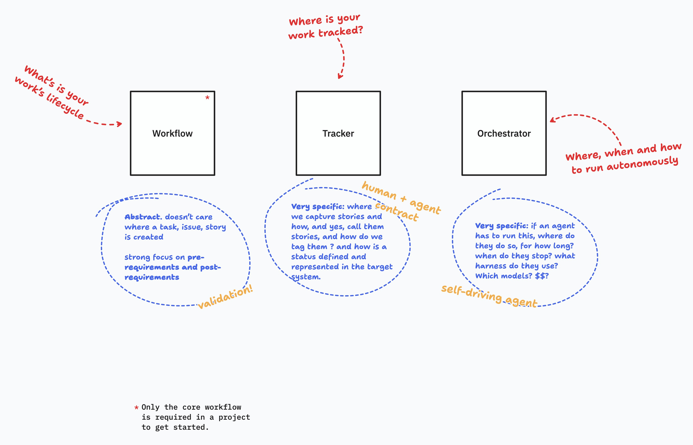

# mstack

mstack helps people and coding agents move software work from a request to a
merged, verified change. Each phase states what must be true before work
enters it and what must be shown before it leaves.

**Status:** draft skills, version 0.2.0. Live runtime and Notion behavior are
not yet validated; see each skill's `CHANGELOG.md` for known limits.



## Why

Agents can write code quickly but often stop at "it looks done". mstack makes
"done" a checkable claim: a story is delivered only when an independent QA
actor has evidence that each acceptance criterion holds on a specific commit,
and the change is merged.

## How it fits together

Three skills, released together at one version:

| Skill | Owns | Use alone? |
| --- | --- | --- |
| [mstack-workflow](skills/mstack-workflow/SKILL.md) | Phases, gates, transitions, verification, project memory | Yes |
| [mstack-tracker](skills/mstack-tracker/SKILL.md) | Where stories live and how their state is recorded | With workflow |
| [mstack-orchestrator](skills/mstack-orchestrator/SKILL.md) | Which agent runs which phase, where and when | With both |

Workflow is the rulebook. Tracker and orchestrator follow its contracts; they
never relax a gate.

## Approach

- **Phases.** Research establishes facts, refinement writes the scope and
  acceptance criteria, implementation produces a reviewable PR, and QA judges
  it. Code defects return to implementation; specification holes return to
  refinement.
- **Gates.** Each phase ends with required questions and pass conditions.
  Unknown is not a pass.
- **Evidence.** Every acceptance criterion maps to scenarios. QA records the
  results, evidence and tested commit on the PR, checks scope and regressions,
  and confirms the reproduction for fixes. A new commit or specification
  change invalidates the verdict.
- **Independence.** The actor that implemented a change cannot give its QA
  verdict.
- **Memory.** Decisions, facts and gotchas go in `.mstack/memory.md`.

## Adopt in a project

1. Install all three skills so cross-references resolve to the same version:

   ```sh
   npx skills add mikemajara/mstack --skill '*'
   ```

2. Keep project instructions and checks in the project's `AGENTS.md`.
3. Choose where stories live: [GitHub Issues](skills/mstack-tracker/references/github.md)
   (set up labels with `skills/mstack-tracker/scripts/github/setup-labels.mjs`),
   [Notion](skills/mstack-tracker/references/notion.md), or, when no tracker is
   selected, the [filesystem](skills/mstack-tracker/references/filesystem.md)
   under `.mstack/issues/`. Each story has one canonical record; an
   unavailable tracker never switches storage automatically.
4. To coordinate agents, add [`.mstack/config.json`](skills/mstack-orchestrator/references/configuration.md).
   Herdr is the supported runtime; a single agent in the current session also
   works.

Try prompts like:

> Use mstack-workflow to refine this request. Identify the acceptance criteria
> and what must be true before implementation can start: [describe the change]

> Use mstack-orchestrator to continue the eligible stories in this project
> through their current workflow phases.

## Releases

One shared version across the three skills. Upgrading a project? Read the
root [CHANGELOG.md](CHANGELOG.md): what's new, what to change in your project,
and what happens to stories in flight. Each skill's own `CHANGELOG.md`
describes the release's effect on that skill, including whether it must adapt.

## Contributing

See [AGENTS.md](AGENTS.md) for contributor guidance and
[docs/STRUCTURE.md](docs/STRUCTURE.md) for file ownership.
