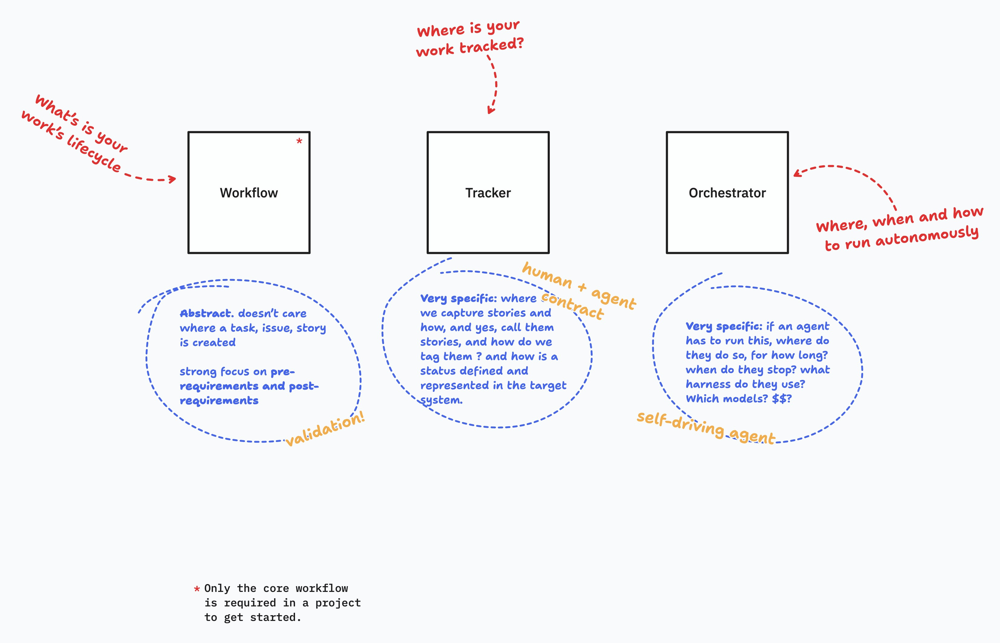

# mstack

mstack helps people and coding agents move software work through a clear delivery lifecycle, with explicit checks for what must be true before and after each phase.



## How it works

The Workflow is the core. It defines the lifecycle from research through refinement, implementation and QA. Each phase has prerequisites, required outputs, exit checks and valid next steps. The lifecycle applies regardless of where a task, issue or story was created.

The Workflow can be used on its own. Add the other skills when a project needs them:

- [mstack-workflow](skills/mstack-workflow/SKILL.md) defines the lifecycle, phase checks, transitions and project memory.
- [mstack-tracker](skills/mstack-tracker/SKILL.md) defines where work is recorded and how records and statuses are represented.
- [mstack-orchestrator](skills/mstack-orchestrator/SKILL.md) coordinates where, when and how agents run work through the lifecycle.

Together, the skills separate the rules for moving work forward, the records that hold its state, and the agents that coordinate it.

## Quick start

Install all three skills so their cross-references resolve within the same release:

```sh
npx skills add mikemajara/mstack --skill '*'
```

The [Skills CLI](https://www.skills.sh/docs/cli) installs skills from GitHub repositories and supports selecting every skill with `--skill '*'`.

Try prompts like these with your coding agent:

> Use mstack-workflow to refine this request. Identify the acceptance criteria and what must be true before implementation can start: [describe the change]

> Use mstack-orchestrator to continue the eligible stories in this project through their current workflow phases.

## Work records

The Tracker supports GitHub Issues and local filesystem records. The local tracker stores issues under `.mstack/issues/`; project memory and optional runtime configuration can also live under `.mstack/`. See the [filesystem tracker](skills/mstack-tracker/references/filesystem.md) and [project configuration](skills/mstack-orchestrator/references/configuration.md) for details.

## Releases

The three skills are released together at one shared version. Each skill has a `CHANGELOG.md` describing the release and its effect on that skill.

## Contributing

This repository develops the mstack skills. See [AGENTS.md](AGENTS.md) for contributor guidance and [STRUCTURE.md](docs/STRUCTURE.md) for file ownership.
