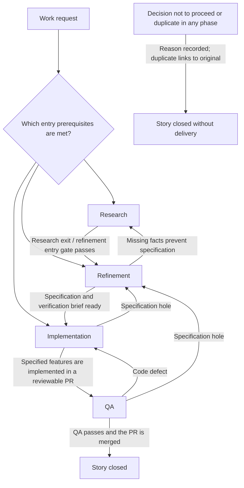
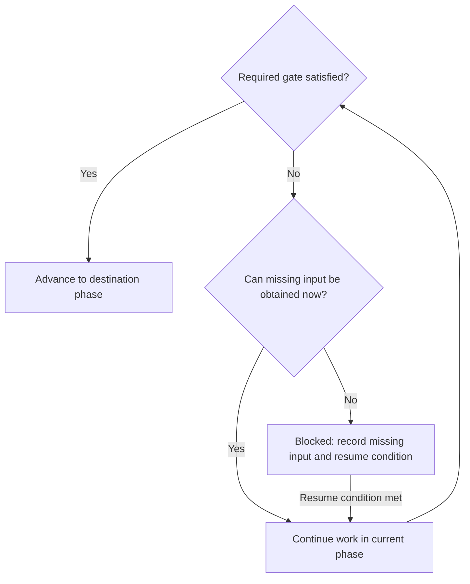

# Lifecycle

This file is the flow across phases: where work can enter, how gates and blocked work behave, and what the phase-file header fields mean. Each phase contract is a file in [phases](phases/).

Draft: detailed phase contracts are incomplete. An unspecified gate is not a pass.

[Research][phase:research] is the earliest phase, not a mandatory entry point. Work can
enter [research][phase:research], [refinement][phase:refinement] or
[implementation][phase:implementation] when the destination's prerequisites are
satisfied. Existing artifacts can satisfy prerequisites; entering later does not waive
them. There is no intake phase.

Arrows summarize gates; read the destination phase contract before advancing.

## Story completion

For delivery, [QA][phase:qa] must pass for the current commit with no intervening
return to refinement. Merge precedes closure. Close the story as delivered
only after confirming that the validated change has been merged. A passing
verdict alone does not close the story, and merging
without passing QA does not satisfy completion.

Until merge is confirmed, the story remains in [QA][phase:qa]. Apply the missing
input and blocked-work rules below when the merge cannot proceed. Merge and
closure must be within the current request and project instructions;
orchestrator defaults to proposing merge after passing QA.

A decision not to proceed closes the story without delivery, with the reason
recorded; a duplicate also links to the original story. These dispositions do
not require QA or merge and must not be recorded as delivered work.

A story is a work item independent of the system that stores it. Tracker owns
the concrete mapping of story closure and links between the story and PR.

## Specification changes

Only [refinement][phase:refinement] changes the specification, including scope,
acceptance criteria and verification scenarios. Existing specifications may
satisfy direct-entry prerequisites without being rewritten. A return to
refinement invalidates earlier QA verdicts for the story, even if the
specification has not yet changed. Record that return with the story so its
verdict link cannot be mistaken for a current pass.

If the specification was changed outside refinement, reconcile the change in
refinement and obtain a new QA verdict before merge. Changes to the tested
commit also require [revalidation](verification.md#judgment). No separate
specification version identifier is required.

## Phase file header

Each phase contract starts with a YAML header. The header names the allowed
destinations; the body states when each applies. `forward` names one phase;
`returns` is a YAML list, including when there is only one allowed return.
Choose the destination using the condition in the body. A missing field means
that destination is not part of the contract. Story closure is a lifecycle
outcome, not another phase.

| Field | Meaning |
| --- | --- |
| `entry` | Whether a story may start in this phase. |
| `output` | The artifact this phase must leave behind. |
| `forward` | The phase a passing exit moves to. |
| `returns` | The phases a gap may send the work back to. |

## Gate contract

Each phase specifies entry prerequisites, required outputs, exit validation and
valid destinations. A transition must satisfy both the source's exit requirements
and destination's entry requirements; reference shared requirements rather than
defining competing versions.

For a forward handoff, the source's exit supplies the destination's entry
prerequisites and preserves required outputs. Readiness for QA also needs an
independent actor assigned before QA starts. Direct-entry and return paths
are checked on their own terms; they need not reproduce an earlier phase's
successful exit.

Required gate questions need supported answers meeting their pass conditions.
Unknown is not a pass. An applicability exception must be explicitly allowed by
the contract and explained.

Investigation prompts guide discovery. Answering every prompt is not required
for advancement. Material findings may reveal an unmet requirement.

## Missing inputs, blocked work and resume

If required input or evidence is obtainable, continue work in the current phase. If it
requires unavailable input, access or an external decision, mark the current phase
[blocked][status:blocked]. Record the missing prerequisite and observable resume
condition. Blocking is a hold on a phase. Resume by rechecking entry prerequisites and
the relevance of existing outputs. Never manufacture an answer to pass a gate.

An unanswered guidance prompt alone does not block advancement. Missing required
verification evidence blocks a pass. Established code defects return to
[implementation][phase:implementation]; specification holes return to
[refinement][phase:refinement].
