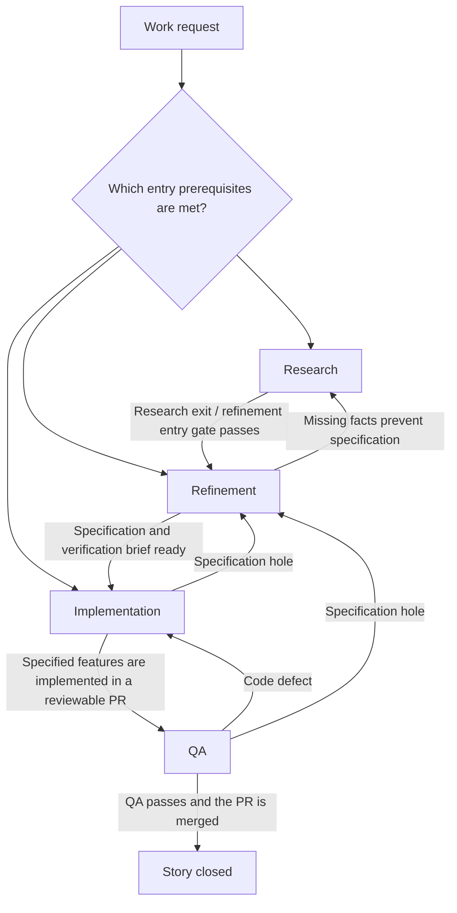
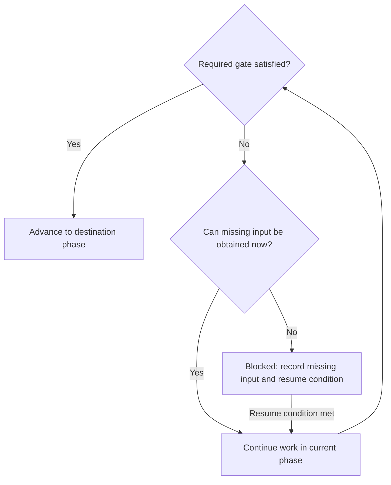

# Lifecycle

This file is the flow across phases: where work can enter, how gates and blocked work behave, and what the phase-file header fields mean. Each phase contract is a file in [phases](phases/).

Draft: detailed phase contracts are incomplete. An unspecified gate is not a pass.

[Research][phase:research] is the earliest phase, not a mandatory entry point. Work can
enter [research][phase:research], [refinement][phase:refinement] or
[implementation][phase:implementation] when the destination's prerequisites are
satisfied. Existing artifacts can satisfy prerequisites; entering later does not waive
them. There is no intake phase.

Arrows summarize gates; read the destination phase contract before advancing.

## Story completion

After [QA][phase:qa] passes for the current change and specification versions,
merge the PR. Close the story only after confirming that the validated change
has been merged. A passing verdict alone does not close the story, and merging
without passing QA does not satisfy completion.

Until merge is confirmed, the story remains in [QA][phase:qa]. Apply the missing
input and blocked-work rules below when the merge cannot proceed. Execution
authority follows orchestrator and project policy.

A story is a work item independent of the system that stores it. Tracker owns
the concrete mapping of story closure and links between the story and PR.

## Phase file header

Each phase contract starts with a header. The header names the allowed destinations. The phase body states when each destination applies. One value and a list are the same kind of fact: the phases that are allowed. A list means the story moves to one of the listed phases, chosen by the condition in the body. A missing field means that destination is not part of the contract.

| Field | Meaning |
| --- | --- |
| `entry` | Whether a story may start in this phase. |
| `output` | The artifact this phase must leave behind. |
| `forward` | The phase a passing exit moves to. |
| `returns` | The phases a gap may send the work back to. |

## Gate contract

Each phase specifies entry prerequisites, required outputs, exit validation and
valid destinations. A transition must satisfy both the source's exit requirements
and destination's entry requirements; reference shared requirements rather than
defining competing versions.

Required gate questions need supported answers meeting their pass conditions.
Unknown is not a pass. An applicability exception must be explicitly allowed by
the contract and explained.

Investigation prompts guide discovery. Answering every prompt is not required
for advancement. Material findings may reveal an unmet requirement.

## Missing inputs, blocked work and resume

If required input or evidence is obtainable, continue work in the current phase. If it
requires unavailable input, access or an external decision, mark the current phase
[blocked][status:blocked]. Record the missing prerequisite and observable resume
condition. Blocking is a hold on a phase. Resume by rechecking entry prerequisites and
the relevance of existing outputs. Never manufacture an answer to pass a gate.

An unanswered guidance prompt alone does not block advancement. Missing required
verification evidence blocks a pass. Established code defects return to
[implementation][phase:implementation]; specification holes return to
[refinement][phase:refinement].
